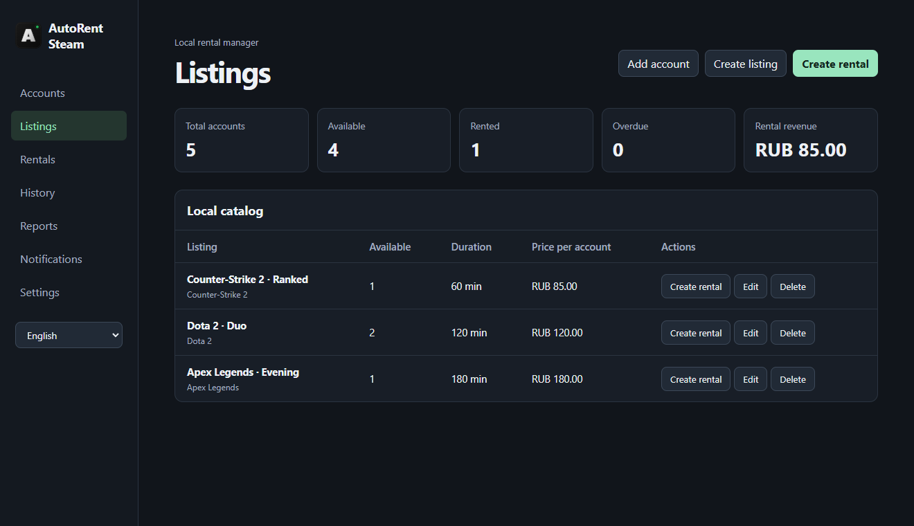

# AutoRent Steam

[Русский](README.md) · [English](README.en.md)

A local dashboard for game accounts, listings and rentals. It opens in a browser without an account, password or activation key. Use the **Language** menu to switch the dashboard and buyer portal between English and Russian.

[Download for Windows x64](https://github.com/hopelanio123-eng/autorent-steam/releases/latest) · [Run from source](#run-from-source)



## Platform support

| Platform | What works |
| --- | --- |
| **Steam** | Organize accounts by game, create listings and record rentals |
| **FunPay and Playerok** | Record the marketplace and order number in rental history |
| **Riot, Epic Games, Rockstar, EA, Battle.net, Wargaming, Lesta** | Track accounts and rentals by platform. Custom platform labels are supported |

AutoRent uses a local database. This edition has no external order sync, listing publication, game account sign-in, code delivery or payment processing.

## Features

- Search, import or export accounts as CSV, and disable or archive accounts.
- Create listings with a per-account price, a rental duration and a live availability count.
- Record rentals for one or several accounts, extend them, close them and review the history.
- Open a buyer portal with a temporary link and review upcoming deadlines in the dashboard.
- Record costs and refunds and view revenue and profit reports.

## Run on Windows

Download `AutoRent-Windows-x64.zip` from [Releases](https://github.com/hopelanio123-eng/autorent-steam/releases/latest), extract the entire archive and run `AutoRent.exe`. The Windows distribution includes its runtime. The dashboard opens in your browser. Close the AutoRent window to stop the app.

## Run from source

Requires Python 3.11 or later. Run these commands in Command Prompt from the project folder.

```bat
py -3 -m venv .venv
.venv\Scripts\python.exe -m pip install -r requirements.txt
start.cmd
```

The dashboard opens on [127.0.0.1:8765](http://127.0.0.1:8765). The SQLite database is created in `data/autorent.sqlite3` beside the app. Set `AUTORENT_DB` to use another database location. Databases from earlier versions of this reconstruction migrate on startup.

Run `build-windows.cmd` to produce a Windows distribution in `dist\AutoRent`.

## Try a rental

1. Add an account or import a UTF-8 CSV with `login` and `game` columns. Keep the `autorent_escaped` column when reimporting an export so formula-protected values round-trip correctly.
2. Create a listing or record a rental manually. For a FunPay or Playerok order, select its source and enter the order number.
3. Open the buyer portal from the rental row. The link works on the same computer and expires when the rental ends or the configured link lifetime is reached.
4. Close the rental and check the history. Record a local refund after closure.

An overdue rental holds the account until you close it. Group rental amounts are split into whole kopecks. Revenue reports group records by UTC day.

## About

This is a local reconstruction. The account, manual rental and dashboard API shapes were checked against the supplied interface and compiled `main.exe`. The FastAPI service and browser dashboard were reimplemented. The original program uses a different database format.
