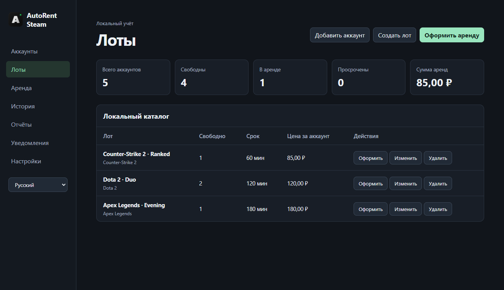

# AutoRent Steam

[Русский](README.md) · [English](README.en.md)

Локальная панель учёта игровых аккаунтов, лотов и аренды. Открывается в браузере без регистрации, пароля и ключа активации. В меню **Язык** можно выбрать русский или английский для панели и портала покупателя.

[Скачать для Windows x64](https://github.com/hopelanio123-eng/autorent-steam/releases/latest) · [Запуск из исходников](#запуск-из-исходников)



## Поддержка платформ

| Платформа | Что работает |
| --- | --- |
| **Steam** | Учёт аккаунтов по играм, лоты и ручная аренда |
| **FunPay и Playerok** | Номер заказа и метка площадки в истории аренды |
| **Riot, Epic Games, Rockstar, EA, Battle.net, Wargaming, Леста** | Учёт аккаунтов и аренды с указанием платформы. Можно ввести своё название |

AutoRent работает с локальной базой. Внешняя синхронизация заказов, публикация лотов, вход в игровые аккаунты, выдача кодов и платежи в этой версии отсутствуют.

## Возможности

- Поиск аккаунтов, импорт и экспорт CSV, отключение и архив.
- Лоты с ценой за аккаунт, сроком и количеством свободных аккаунтов.
- Ручная аренда на один или несколько аккаунтов, продление, закрытие и история.
- Портал покупателя с временной ссылкой и напоминания в панели.
- Учёт расходов и возвратов, отчёты по выручке и прибыли.

## Запуск на Windows

Скачайте `AutoRent-Windows-x64.zip` из [релизов](https://github.com/hopelanio123-eng/autorent-steam/releases/latest), распакуйте архив целиком и запустите `AutoRent.exe`. Python для этой сборки не нужен. Панель откроется в браузере. Чтобы остановить приложение, закройте окно AutoRent.

## Запуск из исходников

Требуется Python 3.11 или новее. Откройте командную строку Windows в папке проекта и выполните команды установки.

```bat
py -3 -m venv .venv
.venv\Scripts\python.exe -m pip install -r requirements.txt
start.cmd
```

Панель открывается на [127.0.0.1:8765](http://127.0.0.1:8765). База SQLite создаётся в `data/autorent.sqlite3` рядом с приложением. Чтобы задать путь к другой базе, используйте переменную `AUTORENT_DB`. Базы предыдущих версий этой реконструкции обновляются при запуске.

Для сборки своего Windows-архива запустите `build-windows.cmd`. Готовые файлы появятся в `dist\AutoRent`.

## Первый сценарий

1. Добавьте аккаунт или импортируйте UTF-8 CSV со столбцами `login` и `game`. При повторном импорте выгрузки сохраните столбец `autorent_escaped`, чтобы восстановить исходный текст защищённых от формул ячеек.
2. Создайте лот или оформите аренду вручную. Для заказа с FunPay или Playerok укажите площадку и номер.
3. Откройте портал покупателя из строки аренды. Ссылка открывается на том же компьютере и действует до конца аренды или до истечения заданного срока доступа.
4. Закройте аренду и проверьте историю. Локальный возврат можно записать после закрытия.

Просроченная аренда занимает аккаунт до ручного закрытия. Сумма групповой аренды делится между аккаунтами в целых копейках. Выручка группируется по дням UTC.

## О проекте

Это локальная реконструкция. Названия и основные поля API аккаунтов, ручной аренды и сводки сверены по интерфейсу и данным из собранного `main.exe`. Сервер на FastAPI и рабочая панель написаны заново. База оригинальной программы имеет другой формат.
